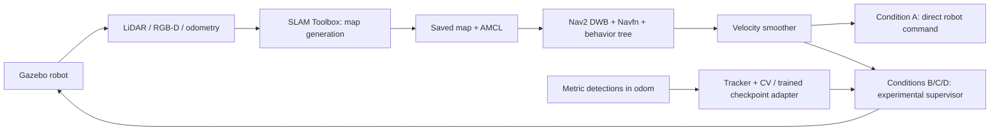

# AI-Powered Autonomous Delivery Robot

ROS 2 Jazzy / Gazebo Harmonic research implementation. **Research project incomplete.**
The custom robot, live simulated-LiDAR SLAM, AMCL and two static-world Nav2 goals
have executed successfully. This does not demonstrate that learned pedestrian
prediction improves navigation. This is experimental software, not a certified controller.

## Executed evidence

- Two ROS packages build in Ubuntu 24.04 / Jazzy inside Docker.
- Custom differential-drive robot publishes LiDAR, RGB, depth, odometry and TF.
- SLAM Toolbox created a new map from simulated sensor observations, with map
  updates during robot motion and a map-to-odom transform.
- AMCL loaded that generated map. Nav2 completed two static-world goals.
- GRU, LSTM and Transformer actually trained for five epochs each on explicitly
  **synthetic software fixtures**, with saved checkpoints and held-out evaluations.
- The authors' ETH/UCY archive was downloaded and structurally validated;
  dataset licensing, units and time metadata remain unverified. No real-data
  model was trained and no real-data navigation study was executed.

Read [mandatory status report](docs/STATUS.md), [research report](docs/RESEARCH_REPORT.md),
[audit](docs/AUDIT.md), and [reproduction instructions](docs/REPRODUCE.md).
Measured files live in [evidence](evidence/). Never substitute these smoke tests
for repeated controlled pedestrian-navigation experiments.

## Architecture



RGB-D deprojection and offline YOLO inference utilities are implemented. The
live camera-to-tracker connection is **not implemented**. Detection messages in
transport tests are synthetic fixtures. Dataset replay uses collision-bearing
cylinder proxies, not photorealistic humans or verified vision inputs.

## Quick start on Ubuntu 24.04 with ROS Jazzy

Install dependencies from [reproduction instructions](docs/REPRODUCE.md), then:

```bash
source /opt/ros/jazzy/setup.bash
cd ros2_ws
colcon build --symlink-install
source install/setup.bash
ros2 launch delivery_robot simulation.launch.py
```

In a second sourced terminal:

```bash
ros2 launch delivery_robot mapping.launch.py
```

Use the documented mapping probe to drive the robot and save a newly generated
map. Stop mapping and the simulator before restarting simulation plus AMCL/Nav2.

## Test and measurement boundaries

Pure tests check numerical behavior. ROS transport tests use synthetic messages
in isolated ROS domain 77. Simulation probes exercise actual Gazebo processes.
The navigation trial measures action completion, simulated elapsed time and
odometry path length; it does not instrument contact collisions or ground-truth
localization error. See each evidence file's labels and provenance.
